# 🖥️ Montaje de un pc gaming 
**Autor:** Barry Osagie Batista

## Índice
- [Introduccion](#Introduccion)
- [Componentes](#Componentes)
- [Presupuesto](#presupuesto)
- [Pasos del montaje](#Pasos_del_montaje)
- [Lista de tareas](#Lista_de_tareas)
- [Rendimiento y consumo](#Rendimiento_y_consumo)
- [Planificación](#Planificación)
- [Enlaces y conclusiones](#Enlaces_y_conclusiones)

### Introduccion

El montaje de un PC gaming consiste en seleccionar, combinar e instalar diferentes componentes informáticos para construir un ordenador diseñado principalmente para jugar a videojuegos. A diferencia de comprar un ordenador ya montado, construirlo desde cero permite elegir cada pieza según nuestras necesidades, **preferencias y presupuesto.** De esta manera, podemos conseguir un equipo personalizado, con un buen rendimiento y con posibilidades de ampliación en el futuro.

Actualmente, los videojuegos requieren cada vez más potencia de procesamiento, memoria y capacidad gráfica. Por este motivo, es importante conocer los componentes principales de un ordenador y comprender la función que desempeña cada uno. Entre los elementos más importantes se encuentran el ***procesador (CPU)**, **la tarjeta gráfica (GPU)**, **la memoria RAM**, la placa base, el almacenamiento SSD, la fuente de alimentación* y la caja o torre. Todos trabajan conjuntamente para que el ordenador funcione correctamente y pueda ejecutar los videojuegos con fluidez y buena calidad visual.

 

Antes de comenzar el montaje, es necesario realizar una planificación para asegurarnos de que todos los componentes sean compatibles entre sí. Por ejemplo, el procesador debe ser compatible con el ***socket de la placa base***, la memoria RAM debe ser del tipo admitido por esta y la fuente de alimentación debe proporcionar suficiente potencia para alimentar todos los componentes. También debemos comprobar que la tarjeta gráfica tenga espacio suficiente dentro de la caja y que el sistema de refrigeración sea adecuado para mantener unas temperaturas correctas.

Una parte fundamental del proyecto es conocer la función de cada componente. El procesador se encarga de ejecutar instrucciones y realizar operaciones; la tarjeta gráfica procesa los gráficos de los videojuegos; la memoria RAM permite trabajar con datos de forma rápida; y el almacenamiento SSD guarda el sistema operativo, los programas y los juegos. Por otro lado, la placa base conecta todos los elementos, mientras que la fuente de alimentación suministra la energía necesaria para que el equipo funcione.

El montaje también requiere prestar atención a la seguridad y al orden de trabajo. Antes de manipular las piezas, debemos trabajar sobre una superficie limpia, estable y bien iluminada, evitar la electricidad estática y manejar los componentes con cuidado. Es importante no forzar ninguna conexión ni colocar una pieza en un lugar que no le corresponda. Además, nunca se debe abrir la fuente de alimentación, ya que puede contener componentes peligrosos incluso cuando está desconectada.


</img>

El objetivo de este proyecto es aprender a montar un ordenador gaming desde cero, conocer sus componentes, comprobar su compatibilidad, calcular un presupuesto e instalar correctamente todas las piezas. Finalmente, se comprobará su funcionamiento y rendimiento mediante diferentes pruebas.

Para conseguirlo, tendremos que elegir los componentes adecuados, realizar el montaje paso a paso, conectar todos los cables e instalar el sistema operativo y los controladores necesarios.

También tendremos en cuenta el rendimiento que queremos conseguir, ya que dependerá de los videojuegos que utilicemos, la calidad gráfica deseada y el presupuesto disponible.

En definitiva, montar un PC gaming permite crear un ordenador personalizado, conocer mejor su funcionamiento interno y aprender a realizar futuras mejoras o solucionar pequeños problemas.

### Componentes

Para montar un PC gaming necesitamos varios componentes que trabajen conjuntamente. Cada uno tiene una función específica y debemos comprobar que sean compatibles antes de comprarlos.

**1\. Procesador (CPU)**

Es el cerebro del ordenador. Se encarga de ejecutar instrucciones y realizar cálculos. Algunos fabricantes conocidos son AMD e Intel.

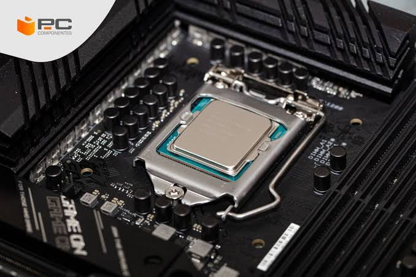

**2\. Tarjeta gráfica (GPU)**

Se encarga de generar los gráficos de los videojuegos y permite conseguir una buena calidad visual y FPS.

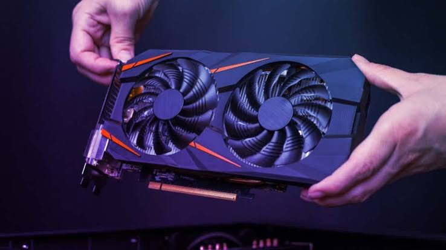

**3\. Placa base**

Conecta todos los componentes del ordenador. Debe ser compatible con el procesador y la memoria RAM.

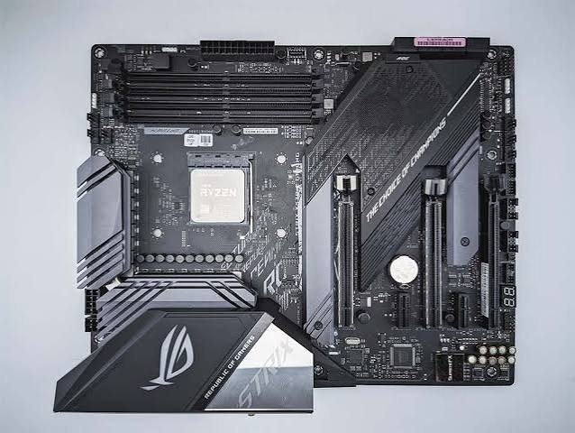

**4\. Memoria RAM**

Almacena temporalmente los datos que utiliza el ordenador. Para gaming, 16 GB o 32 GB son capacidades habituales.

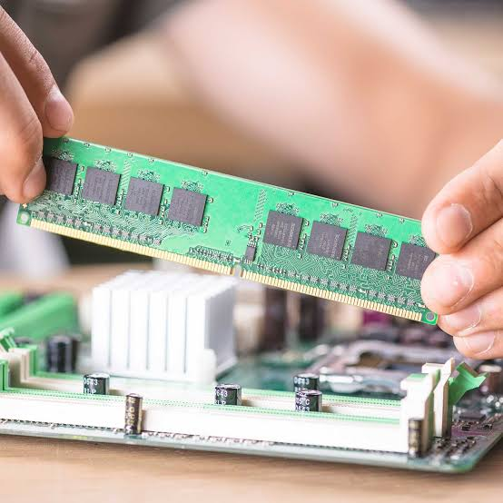

**5\. Almacenamiento SSD**

Permite guardar juegos, programas y archivos. Los SSD NVMe destacan por su gran velocidad.

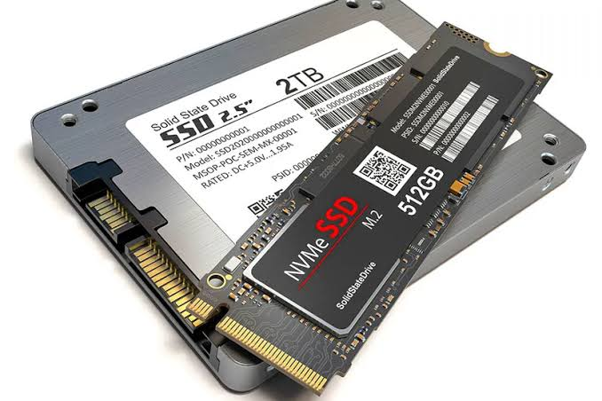

**6\. Fuente de alimentación (PSU)**

Proporciona energía a todos los componentes. Debe tener suficiente potencia y ser de buena calidad.

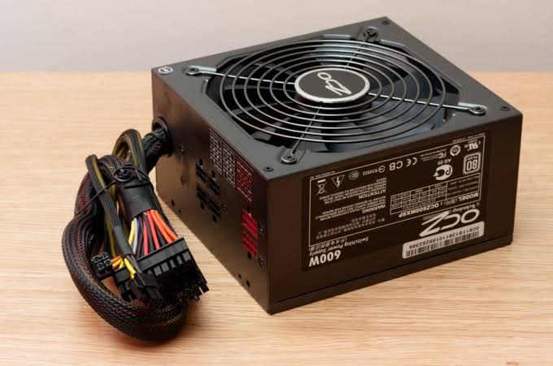

**7\. Caja o torre**

Contiene y protege los componentes. Debe tener espacio suficiente y buena ventilación.

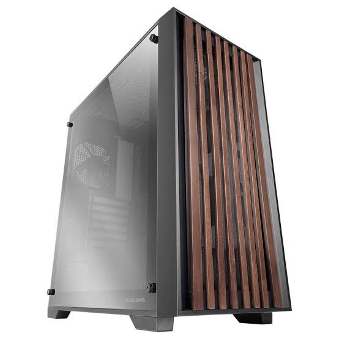

**8\. Refrigeración**

Mantiene temperaturas adecuadas mediante ventiladores o refrigeración líquida, evitando el sobrecalentamiento.

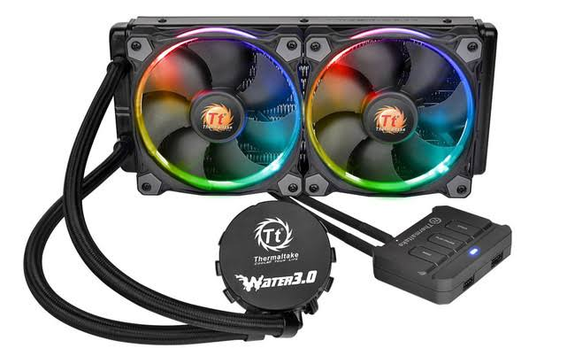

## Tabla resumen de componentes

| Componente | Función principal | Importancia |
| --- | --- | --- |
| Procesador | Ejecutar instrucciones | Alta |
| Tarjeta gráfica | Generar gráficos | Muy alta |
| Placa base | Conectar componentes | Alta |
| Memoria RAM | Almacenar datos temporales | Alta |
| SSD | Guardar archivos y juegos | Media |
| Fuente | Suministrar energía | Muy alta |
| Caja | Proteger los componentes | Media |
| Refrigeración | Controlar temperaturas | Alta |

**Compatibilidad de los componentes**

Antes de comprar debemos comprobar:

- Que el procesador y la placa base sean compatibles.
  
- Que la memoria RAM sea compatible.
  
- Que la tarjeta gráfica quepa en la caja.
  
- Que la fuente tenga potencia suficiente.
  
- Que la refrigeración sea adecuada.
  

En conclusión, elegir correctamente los componentes permite construir un ordenador equilibrado, seguro y con buen rendimiento.

### [Presupuesto]
[⬆️ Volver al índice](#presupuesto)


Para montar un PC gaming es importante establecer un presupuesto antes de comprar los componentes. El precio dependerá de la potencia que queramos conseguir y de la calidad de las piezas.

A continuación, se muestra un presupuesto orientativo para un ordenador gaming de gama media.

## Tabla de precios

| Componente | Precio aproximado |
| --- | --- |
| Procesador (CPU) | 200 € |
| Tarjeta gráfica (GPU) | 350 € |
| Placa base | 120 € |
| Memoria RAM (32 GB) | 70 € |
| SSD (1 TB) | 70 € |
| Fuente de alimentación | 85 € |
| Caja gaming | 70 € |
| Refrigeración | 40 € |
| **TOTAL** | **1.005 €** |

Los precios pueden variar dependiendo de la marca, el modelo y la tienda donde compremos los componentes.


## Comprobación del presupuesto

Podemos calcular el coste total sumando el precio de todas las piezas:

$$
P = 200 + 350 + 120 + 70 + 70 + 85 + 70 + 40 = 1005,€
$$

Para ahorrar dinero, podemos comparar precios en diferentes tiendas como [PcComponentes](https://www.pccomponentes.com/ "Tienda de componentes informáticos") o [PCPartPicker](https://pcpartpicker.com/ "Comparador y comprobador de compatibilidad").

**Distribución del presupuesto**

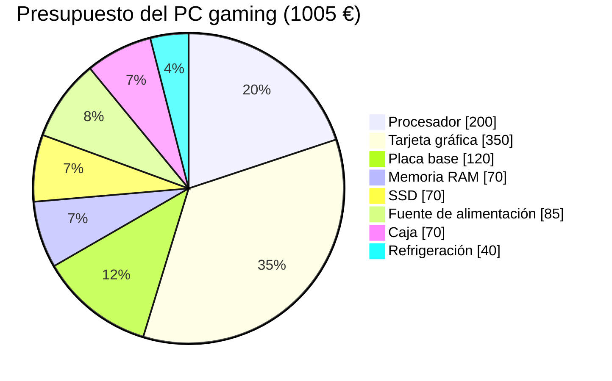

> \[!WARNING\]  
> No debemos elegir los componentes únicamente por su precio. Es importante priorizar la calidad, la compatibilidad y el rendimiento.

#### Antes de comprar

- Comparar precios entre tiendas.
  
- Comprobar la compatibilidad de las piezas.
  
- Revisar las garantías.
  
- Comprobar que no superamos el presupuesto.
  

<!-- El presupuesto puede actualizarse según las ofertas disponibles. -->

En conclusión, con un presupuesto aproximado de **1.000 €** podemos plantear un PC gaming equilibrado, aunque el precio final dependerá de los componentes elegidos.

### Pasos del montaje

Una vez elegidos los componentes, comenzamos el montaje del ordenador. Es importante seguir un orden para evitar errores y asegurarnos de que todas las piezas quedan correctamente instaladas.

**Pasos principales:**

1. **Preparar las herramientas:** destornillador, superficie limpia y pulsera antiestática si disponemos de ella.
   
2. **Instalar los componentes principales:** colocar el procesador, la memoria RAM y el SSD en la placa base.
   
3. **Montar la placa base:** fijarla dentro de la caja y colocar la fuente de alimentación.
   
4. **Instalar la tarjeta gráfica y la refrigeración:** conectar sus cables y comprobar que estén bien sujetas.
   
5. **Conectar y revisar:** organizar los cables, encender el ordenador y comprobar que funciona correctamente.
   


**⚠️ Precaución:** Antes de manipular los componentes, debemos desconectar la fuente de alimentación de la corriente y evitar la electricidad estática. Nunca debemos forzar las conexiones.

**Cálculo de la potencia necesaria**

Durante el montaje debemos comprobar que la fuente de alimentación tenga potencia suficiente. Por ejemplo, suponiendo que nuestro equipo consume:

- CPU: 120 W
  
- GPU: 250 W
  
- Resto de componentes: 110 W
  

Podemos añadir un margen del 30 % mediante la siguiente operación:


```
$$
P_{\text{base}} = 120 + 250 + 110 = 480\,\mathrm{W}
$$

$$
P_{\text{recomendada}} = 480 \times 1{,}3 = 624\,\mathrm{W} \approx 650\,\mathrm{W}
$$
```


Por tanto, en este ejemplo elegiríamos una fuente de **650 W**, comprobando también las recomendaciones del fabricante.

**Esquema del montaje**

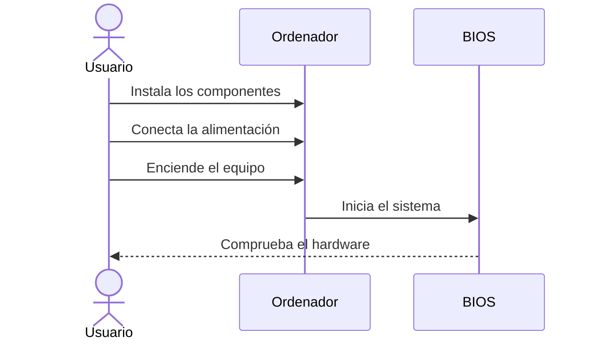


**Diagrama de flujo del montaje**

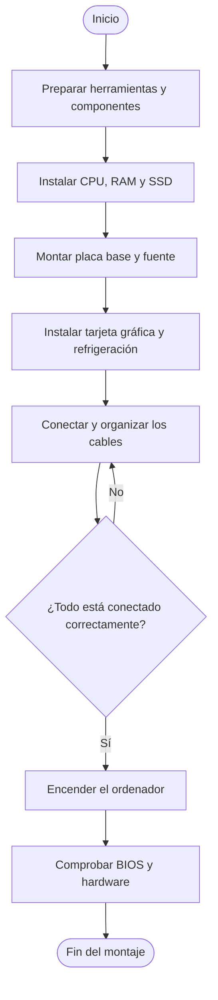


<!-- Comprobar todas las conexiones antes del primer encendido. -->

Para finalizar, debemos verificar que los ventiladores funcionan, que la memoria RAM se detecta correctamente y que el ordenador arranca sin errores.


### Lista_de_tareas

Para organizar correctamente el proyecto, podemos utilizar una lista de tareas que nos permita comprobar qué actividades hemos realizado y cuáles quedan pendientes. De esta manera, evitaremos olvidar pasos importantes durante la preparación, el montaje y la configuración del ordenador.

**📋 Tareas pendientes del proyecto**

**1. Preparación y planificación**

- [ ] Establecer el presupuesto máximo para el ordenador.
- [ ] Comprobar la compatibilidad entre el procesador, la placa base y la memoria RAM.
- [ ] Revisar las dimensiones de la tarjeta gráfica y de la caja.
- [ ] Consultar los manuales de los componentes antes de comenzar.

**2. Montaje del ordenador**

- [ ] Preparar una superficie de trabajo limpia y evitar la electricidad estática.
- [ ] Comprobar que todos los componentes y accesorios estén disponibles.
- [ ] Revisar las conexiones de alimentación de la placa base y de la tarjeta gráfica.
- [ ] Organizar los cables para facilitar la ventilación del equipo.

**3. Configuración y pruebas**

- [ ] Acceder a la BIOS/UEFI para comprobar que se detectan los componentes.
- [ ] Instalar el sistema operativo.
- [ ] Instalar los controladores de la tarjeta gráfica y de la placa base.
- [ ] Comprobar las temperaturas del procesador y de la tarjeta gráfica.
- [ ] Realizar pruebas de rendimiento con algún videojuego.

**✅ Comprobación final**

Cuando todas las tareas estén completadas, podremos considerar que el montaje y la configuración inicial del ordenador han finalizado correctamente.

<!-- Las casillas se pueden marcar con una X cuando se complete cada tarea. -->

### Rendimiento_y_consumo

El rendimiento de un PC gaming depende principalmente del procesador, la tarjeta gráfica y la memoria RAM. Para medirlo podemos utilizar los **FPS (fotogramas por segundo)**, que indican la fluidez con la que se muestran los videojuegos.

Podemos calcular los FPS mediante la siguiente expresión:

$FPS = \frac{\text{Fotogramas mostrados}}{\text{Tiempo en segundos}}$

También debemos tener en cuenta el consumo eléctrico. Por ejemplo, suponiendo que el ordenador mantiene un consumo medio de 480 W durante 3 horas:

$$
E = 0{,}48 \times 3 = 1{,}44\ \text{kWh}
$$

Si suponemos un precio de 0,20 € por kWh, el coste aproximado sería:

$$
C = 1{,}44 \times 0{,}20 = 0{,}288\ € \approx 0{,}29\ €
$$

Para terminar, es recomendable comprobar las temperaturas del procesador y de la tarjeta gráfica durante los videojuegos, evitando el sobrecalentamiento y manteniendo una buena ventilación.


### Planificación


### Planificación

Para organizar el montaje del ordenador, podemos dividir el trabajo en diferentes fases y establecer una duración aproximada para cada una.

**Diagrama de Gantt del proyecto**

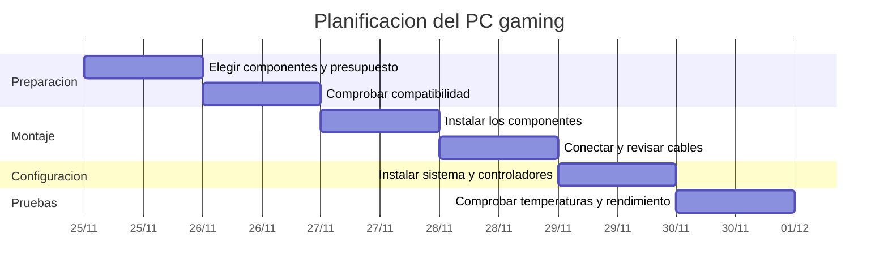

### Enlaces_y_conclusiones

Durante la elaboración de este proyecto hemos consultado diferentes páginas web que nos han ayudado a conocer mejor los componentes, sus características y el proceso de montaje de un ordenador gaming.

**🔗 Recursos y páginas de interés**

- [Intel - Guía para montar un PC gaming](https://www.intel.com/content/www/us/en/gaming/resources/how-to-build-a-gaming-pc.html "Guía de montaje de ordenadores de Intel").
- [PCPartPicker](https://pcpartpicker.com/ "Herramienta para comparar componentes y comprobar compatibilidades").
- [PcComponentes](https://www.pccomponentes.com/ "Tienda de componentes informáticos").

**📁 Archivos locales del proyecto**

También podemos consultar algunas de las imágenes utilizadas en este documento:

- [Fotografía del PC gaming](img/pcGaming1.jpg "Imagen del ordenador gaming").
- [Fotografía del procesador](img/procesador.jpg "Imagen del procesador").
- [Fotografía de la tarjeta gráfica](img/tarjeta_grafica.jpg "Imagen de la GPU").

**💬 Cita relacionada con el proyecto**

> Todos los componentes deben ser compatibles entre sí.
>
> — Intel, guía de montaje de PC gaming (traducción propia).

**⚠️ Recomendaciones finales**

> [!TIP]
> Es recomendable comparar diferentes componentes y consultar sus especificaciones antes de realizar una compra.

> [!NOTE]
> Los precios y consumos utilizados en este proyecto son orientativos y pueden variar dependiendo de los modelos y las condiciones de uso.

**🏁 Conclusiones**

Realizar este proyecto nos ha permitido conocer los principales componentes de un ordenador gaming, comprender sus funciones y aprender la importancia de comprobar su compatibilidad antes de realizar el montaje.

También hemos aprendido a calcular un presupuesto, estimar el consumo eléctrico y organizar las diferentes fases de instalación y configuración.

En definitiva, montar un PC gaming es una buena forma de aprender cómo funciona un ordenador por dentro y adquirir conocimientos que nos servirán para realizar futuras ampliaciones y solucionar posibles problemas.

<p align="center">
  <strong>🖥️ ¡Proyecto de montaje de PC gaming!</strong>
</p>

<details>
<summary>📌 Información adicional</summary>

Este documento forma parte de un proyecto educativo sobre hardware, montaje y configuración de ordenadores personales.

</details>

[⬆️ Volver al índice](#índice)

